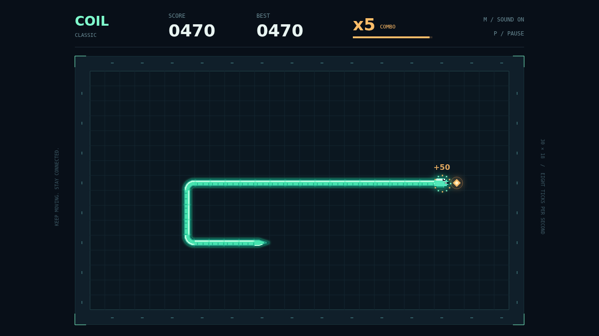

Coil is a neon grid serpent built for a quick mind and a continuous line. Guide a luminous mint snake through a dark circuit of cells, chasing amber pellets while keeping a route open behind you.

The serpent moves without stopping. Turn at right angles, thread through your own trail, and remember that every pellet makes the coil one cell longer. The solid border and your own body turn a careless move into the end of a round.

Survival is only the beginning. Eat again before the combo bar empties and your next pellet is worth more, climbing to a fivefold multiplier. Plan a short route, commit to the turn, and keep the chain alive.

Play Classic with the arrow keys or WASD, pause whenever you need a breath, and try again to beat your session best. Sharp bites, bright combo chimes, and a quiet electronic pulse mark the rhythm of the run.

